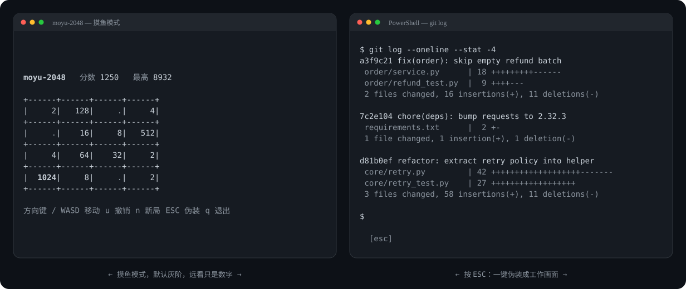

# 🐟 moyu-2048

**一个会伪装成 `git log` 的终端 2048。**

零依赖，一条命令，Windows / macOS / Linux 通用。默认灰阶显示，远看只是在终端里翻一个数据文件；按下 `ESC`，整块屏幕立刻变成一份正常的 `git log` / `pytest` / `docker build` 输出，再按一次 `ESC` 回到游戏。



[](https://github.com/Linyan30/moyu-2048/actions/workflows/ci.yml)


## 为什么会有这个项目

上班摸鱼最大的风险，不是游戏太好玩，而是屏幕看起来不像在工作。

- 没有窗口、没有声音、没有浏览器标签页，只有终端里的一屏文字；
- 默认灰阶，方块只是数字，远看和查看日志没区别；
- 表格默认用纯 ASCII 字符，中文控制台里也不会错位（`--unicode` 再换成制表符）；
- `ESC` 老板键整屏切换，切走之后连棋盘都不在屏幕上；
- 不联网、不写注册表、不留系统托盘，统计只落在 `~/.moyu2048/stats.json`。

## 快速开始

需要 Python 3.9+，不需要安装任何第三方包。

```bash
git clone https://github.com/Linyan30/moyu-2048.git
cd moyu-2048
python -m moyu2048
```

想用 `moyu` 这个短命令：

```bash
pip install .
moyu
```

## 按键

| 按键 | 作用 |
| :--- | :--- |
| `←` `↑` `→` `↓` / `WASD` / `hjkl` | 移动 |
| `u` | 撤销上一步（最多 20 步） |
| `n` | 开新局 |
| `ESC` | 老板键：切到伪装画面 / 切回来 |
| `q` | 退出 |

## 老板键

伪装画面准备了四份素材，每次进入随机挑一份：

- `git log --oneline --stat`
- `pytest -q --cov`
- `docker compose build`
- `git status` + `git diff --stat`

想让程序一启动就是伪装状态：

```bash
moyu --boss
```

在伪装画面里按 `ESC` 回到游戏，按 `q` 直接退出。

> 老板键只管终端这一块：任务栏、窗口标题、鼠标位置它管不了，建议全屏终端使用。

## 摸鱼统计

```text
$ moyu --stats
 累计摸鱼  5 小时 12 分
 完成对局  18 局
 累计步数  1,204
 最高分    8,932
 按时薪 50 元算，你已经摸回 ¥260
```

时薪可以自己改：`moyu --stats --rate 80`。

退出时也会打印本次的摸鱼小结，数据存在 `~/.moyu2048/stats.json`。想完全不留痕：

```bash
MOYU2048_HOME=$(mktemp -d) moyu
```

Windows PowerShell 里用 `$env:MOYU2048_HOME = "$env:TEMP\moyu"`。

## 常用参数

| 参数 | 说明 |
| :--- | :--- |
| `--size N` | 棋盘边长，3–8，默认 4 |
| `--color` | 彩色方块（默认灰阶，更低调） |
| `--unicode` | 用制表符画边框，更好看；部分中文终端会错位，默认不开 |
| `--boss` | 启动即进入伪装画面 |
| `--stats` | 打印摸鱼统计后退出 |
| `--rate R` | 时薪，用于折算摸鱼收益，默认 50 |
| `--reset` | 清空统计 |
| `--demo N` | 自动随机走 N 步后打印棋盘（CI 冒烟测试用） |
| `--seed N` | 固定随机种子，方便复现 |

## 开发

```bash
python -m unittest discover -s tests -v
python -m moyu2048 --demo 200 --seed 7
python tools/make_demo_svg.py   # 重新生成 README 里的演示图
```

代码结构：

```text
moyu2048/
  game.py        # 2048 规则，纯逻辑，无 I/O，方便单测
  render.py      # 棋盘、分数条和摸鱼小结的渲染
  camouflage.py  # 老板键的四份伪装输出
  input.py       # 跨平台按键读取（Windows / POSIX）
  stats.py       # 本地摸鱼统计
  cli.py         # 参数解析和主循环
tests/           # unittest，同样零依赖
tools/           # 生成 README 演示图
.github/         # GitHub Actions：三平台 × 两个 Python 版本
```

## 仓库信息

- **Description**：`一个会伪装成 git log 的终端 2048，按下 ESC 秒变工作画面`
- **Topics**：`python` `cli` `game` `2048` `terminal` `boss-key` `fun`

## 说明

- 表格默认用 ASCII 字符：中文 Windows 控制台会把「─」「│」「·」按两格宽渲染，制表符边框会错位，ASCII 不会；
- 窗口比内容窄时，超出的部分会被截断，不会自动换行把整屏顶乱；
- 不联网、不写注册表，统计只存在 `~/.moyu2048/stats.json`，删掉即可。

## English

A zero-dependency terminal 2048 that disguises itself as a `git log` / `pytest` / `docker build` screen when you press `ESC`. Pure Python 3.9+, runs on Windows, macOS and Linux.

```bash
python -m moyu2048        # play
moyu --boss               # start in disguise mode
moyu --stats              # how much have you slacked off?
```

## License

MIT
